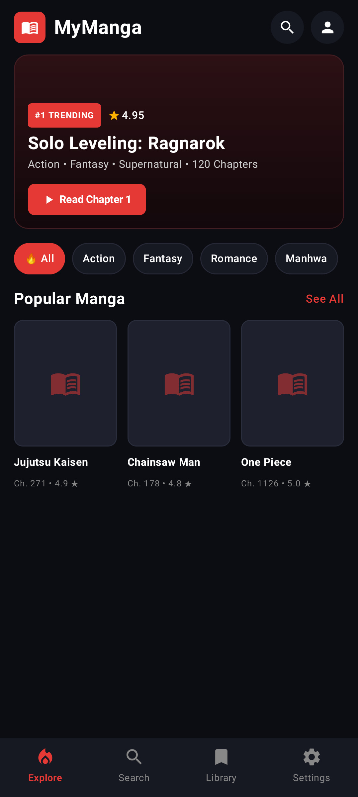

 <p align="center">
  
</p>

<h1 align="center">MyManga</h1>

<p align="center">
  <b>A modern Manga & Webtoon Reader for Android, built with Kotlin, Jetpack Compose and Material 3.</b>
</p>

<p align="center">
  
  
  
  
  
</p>

<p align="center">
  <a href="https://github.com/MyMangaApp/MyManga/releases">
    
  </a>
  <a href="https://github.com/MyMangaApp/MyManga">
    
  </a>
</p>

---

## 📱 App Screenshots

### 🏠 Home, Search and Library

<p align="center">
  
  
  
</p>

### 📖 Manga Reader

<p align="center">
  
  
</p>

### 📊 Activity, Profile and Settings

<p align="center">
  
  
  
</p>

---

## ✨ Key Features

### 🎨 Modern User Interface
- Material Design 3 components with a modern reading interface.
- Responsive layouts and Jetpack Compose-based UI.
- Customizable reader preferences.
- Improved profile interface with premium pastel styling.
- Smooth horizontal reading gestures.

### 📚 Manga Discovery and Search
- Browse and search manga from supported sources.
- Multi-source manga provider integration.
- Manga metadata, catalog and search functionality.
- Curated manga catalog support.
- Provider selection and chapter fallback.

**Supported Manga Providers:**
- MangaPill
- MangaDex
- MangaFire
- MangaBuddy
- WeebCentral

Additional integrations include AniList-related functionality where supported.

*Provider availability and functionality may depend on the source website, network access and current implementation.*

### 📖 Manga and Webtoon Reader
- Reading interface for manga and webtoon content.
- Reader navigation and progress tracking.
- Horizontal and vertical reading modes.
- Smooth horizontal page-swiping gestures.
- Volume-key navigation support where implemented.
- Reading history and bookmarks.
- Chapter continuity when switching providers.
- Improved reader controls and app bar.

### 📥 Library and Downloads
- Save manga to your personal library.
- Organize reading progress and bookmarks.
- Track reading activity.
- Download-related data models and functionality.
- Local storage for supported app data.

### 📊 Reading Analytics
- Reading activity tracking.
- Reading-time statistics.
- Reading streak tracking.
- Reading analytics dashboard.
- Personalized reading statistics.

### 👤 Profile Customization
- Personalized profile information.
- Anime avatar selection.
- Member Since tracking.
- Interactive Member Since date editor.
- Automatic date recovery from reading activity.
- Premium Profile Status Share Card.
- Top 3 most-read manga showcase.
- High-resolution PNG profile card export.
- Reading statistics and streak visualization.

### 💾 Backup and Restore
- JSON-based data backup and restoration.
- Export manga reading data to phone storage.
- Automatic backup worker and scheduling components.
- 24-hour backup reminders.
- Background backup notifications.
- Backup status indicators.
- Direct backup restoration from the Welcome Screen.
- Automatic Member Since date recovery during restoration.

### 🔔 Notifications and Updates
- Notification scheduling and background worker components.
- Boot-related receiver support.
- In-app update dialog and update information interface.
- 24-hour backup protection notifications.
- What's New dialog and release information.
- One-time What's New chip dismissal.

### 🎬 Anime Streaming Integration
- Updated AniFlix series streaming URL integration.
- One-tap anime streaming launch.
- Brave Browser detection and integration.

*Streaming availability depends on the external website and its current functionality.*

---

## 🆕 What's New in v2.6.1 (Build 4)

**Release:** v2.6.1  
**Build:** 4  
**Previous Version:** v2.6.0 (Build 3)

MyManga v2.6.1 introduces major improvements to manga provider reliability, profile customization, data protection, backup restoration and reader usability.

### 🎨 Premium Profile Share Card Overhaul

- Replaced the previous dark theme with a premium pastel lavender and cream theme.
- Added subtle gradient backgrounds.
- Added the official MyManga app logo badge in the top-right corner.
- Removed the generic "Official Reader Card" label.
- Added a Top 3 most-read manga showcase.
- Added gold, silver and bronze ranking badges.
- Redesigned reading statistics cards.
- Added Chapters Read, Read Time and Day Streak statistics.
- Added `mymanga.ai.studio` branding to the footer.
- Added "Read unlimited manga on MyManga" footer text.
- Improved shadows, spacing and typography.
- Updated the in-app preview to match the exported high-resolution PNG.

### 📅 Member Since Tracking and Restoration

- Added original account creation date tracking.
- Added Member Since display to the Profile screen and share card.
- Fixed Member Since resetting to the current date during backup restoration.
- Added date recovery from backup metadata.
- Added date recovery from bookmarks, reading history and downloads.
- Added automatic database activity date correction.
- Added an interactive Member Since date editor.
- Added DD/MM/YYYY date validation.
- Added "Auto-detect from reading activity" functionality.

### 🌐 Multi-Source Manga Providers

Added support for five manga providers:

1. MangaPill
2. MangaDex
3. MangaFire
4. MangaBuddy
5. WeebCentral

Additional improvements:

- Improved chapter availability through provider fallback.
- Fixed chapter switching between providers.
- Preserved the current chapter number when switching sources.
- Added a customizable default manga provider setting.

### 📦 24-Hour Backup Protection

- Added a 24-hour backup reminder system.
- Added direct JSON data export to phone storage.
- Added an option to enable 24-hour automatic backup updates.
- Added WorkManager-based background backup scheduling.
- Added backup reminder postponement for 24 hours.
- Added background backup notifications.
- Added a backup status banner in Settings.
- Added warning indicators when backup protection is inactive.
- Added a green status indicator when automatic backup is enabled.

### 📂 Returning User Welcome Screen

- Added "Import Old MyManga Data 📦" to the initial Welcome / Username dialog.
- Added direct backup restoration without entering a temporary username.
- Improved reinstall and device-switch restoration workflows.
- Restores username, anime avatar, bookmarks, reading history and streaks.

### 🎬 Updated Anime Streaming Integration

Updated the streaming URL structure to:

```text
https://aniflix-org.lovable.app/series/8/{anime-name}/s1/e1
```

Example:

```text
https://aniflix-org.lovable.app/series/8/jujutsu-kaisen/s1/e1
```

- Updated the AniFlix series URL format.
- Added automatic Brave Browser detection.
- Improved one-tap streaming launch.

### 📖 Reader Experience Improvements

- Removed redundant controls from the reader top app bar.
- Fixed horizontal reading gesture conflicts.
- Improved left and right page-swiping behavior.
- Fixed horizontal reading mode getting stuck.
- Improved reading navigation usability.

### ⚙️ Settings Improvements

- Added interactive What's New functionality.
- The What's New chip disappears after being tapped once.
- Dismissal state persists across app launches.
- Improved settings interface cleanliness.

### 🛠️ Technical Improvements

- Improved backup restoration logic.
- Enhanced reading activity date detection.
- Added database-based Member Since correction.
- Improved WorkManager backup scheduling.
- Improved cross-provider chapter mapping.
- Enhanced persistent settings behavior.
- Improved gesture detection and reader interaction.

---

## 📊 Version Comparison

| Feature | v2.6.0 (Build 3) | v2.6.1 (Build 4) |
|---|---|---|
| Profile Share Card | Dark theme | Premium pastel theme |
| Manga Showcase | Previous design | Top 3 ranked manga |
| Member Since | Missing / inaccurate | Tracking, restoration and editing |
| Manga Providers | Limited selection | 5 integrated providers |
| Chapter Switching | Could jump to latest | Preserves current chapter |
| Default Provider | Previous configuration | User-configurable |
| Horizontal Reader | Gesture conflicts | Improved page swiping |
| Data Protection | Manual export | 24-hour backup reminders |
| Automatic Backup | Previous configuration | WorkManager scheduling |
| Welcome Screen | Username required | Direct backup import |
| Anime Streaming | Previous URL | Updated AniFlix series URL |
| Brave Integration | Previous behavior | Browser detection |
| What's New | Static | Interactive dismissal |

---

## 🛠️ Technology Stack

| Technology | Purpose |
|---|---|
| Kotlin | Primary programming language |
| Jetpack Compose | Android UI framework |
| Material 3 | UI components and design system |
| Android SDK | Application platform |
| Room / SQLite | Local database components |
| DataStore | Local preference storage |
| Kotlin Coroutines | Asynchronous operations |
| WorkManager | Background task support |
| Gradle Kotlin DSL | Build configuration |

The exact libraries and versions used by the project are defined in `gradle/libs.versions.toml` and the Gradle build files.

---

## 📂 Project Structure

```text
MyManga/
├── app/
│   ├── src/
│   │   ├── main/
│   │   │   ├── java/com/example/
│   │   │   │   ├── data/
│   │   │   │   │   ├── local/
│   │   │   │   │   ├── model/
│   │   │   │   │   ├── network/
│   │   │   │   │   └── repository/
│   │   │   │   ├── ui/
│   │   │   │   │   ├── components/
│   │   │   │   │   ├── navigation/
│   │   │   │   │   ├── screens/
│   │   │   │   │   │   ├── detail/
│   │   │   │   │   │   ├── explore/
│   │   │   │   │   │   ├── library/
│   │   │   │   │   │   ├── maintenance/
│   │   │   │   │   │   ├── profile/
│   │   │   │   │   │   ├── reader/
│   │   │   │   │   │   ├── search/
│   │   │   │   │   │   └── settings/
│   │   │   │   ├── theme/
│   │   │   │   └── utils/
│   │   │   ├── res/
│   │   │   └── AndroidManifest.xml
│   │   ├── test/
│   │   └── androidTest/
│   ├── build.gradle.kts
│   └── proguard-rules.pro
├── gradle/
│   └── libs.versions.toml
├── screenshots/
│   ├── logo.png
│   ├── Home_screen.jpeg
│   ├── Search_screen.jpeg
│   ├── Library_screen.jpeg
│   ├── Manga_screen.jpeg
│   ├── Manga_screen2.jpeg
│   ├── Activity_screen.jpeg
│   ├── Profile_screen.jpeg
│   ├── Settings_screen.jpeg
│   └── README.md
├── build.gradle.kts
├── gradle.properties
├── metadata.json
├── settings.gradle.kts
├── .gitignore
├── .env.example
├── LICENSE
└── README.md
```

---

## 🚀 Getting Started

### Prerequisites

- Android Studio compatible with the project's Gradle and Android Gradle Plugin versions.
- A compatible JDK as required by the Gradle configuration.
- Android SDK Platform 35 for the uploaded project configuration.
- Android 6.0 (API 23) or newer to run the app, according to the current `minSdk` setting.

### 1. Clone the repository

```bash
git clone https://github.com/MyMangaApp/MyManga.git
cd MyManga
```

### 2. Open the project

Open the cloned project directory in Android Studio and allow Gradle to synchronize dependencies.

### 3. Configure local secrets if required

The project includes an `.env.example` file for configuration.

If a required service needs credentials, configure them locally using the project's expected format.

**Never commit real API keys, passwords, signing credentials or other secrets to the public repository.**

### 4. Build the debug APK

**Windows:**

```powershell
.\gradlew.bat assembleDebug
```

**Linux / macOS:**

```bash
./gradlew assembleDebug
```

### 5. Build the release APK

**Windows:**

```powershell
.\gradlew.bat assembleRelease
```

**Linux / macOS:**

```bash
./gradlew assembleRelease
```

The APK output is normally generated under:

```text
app/build/outputs/apk/
```

Build success and APK signing depend on the project's configuration and local environment. Test the resulting APK before distributing it.

---

## 📥 Download MyManga

Visit the official GitHub Releases page to find available application versions.

<p align="center">
  <a href="https://github.com/MyMangaApp/MyManga/releases">
    
  </a>
</p>

Older releases may remain available for users who need a previous version.

Check each release's notes and assets before installing.

---

## 🤝 Contributing

Contributions, bug reports and suggestions are welcome.

1. Fork the repository.
2. Create a branch for your changes.
3. Make and test your changes.
4. Submit a pull request describing the improvements.

Please include reproducible steps when reporting bugs.

---

## 📄 License and Disclaimer

MyManga is distributed under the **GNU General Public License v3.0 (GPL-3.0)**.

See the [`LICENSE`](LICENSE) file for the applicable terms.

Manga titles, artwork, trademarks and other third-party intellectual property belong to their respective owners.

MyManga does not claim ownership of third-party content accessed through supported sources. Users are responsible for complying with applicable laws and the terms of the relevant content providers.

---

<p align="center">
  <b>MyManga — Your manga library, your reading journey.</b>
</p>

<p align="center">
  <a href="https://github.com/MyMangaApp/MyManga">GitHub Repository</a>
  ·
  <a href="https://github.com/MyMangaApp/MyManga/releases">Releases</a>
  ·
  <a href="https://github.com/MyMangaApp/MyManga/issues">Report an Issue</a>
</p>
