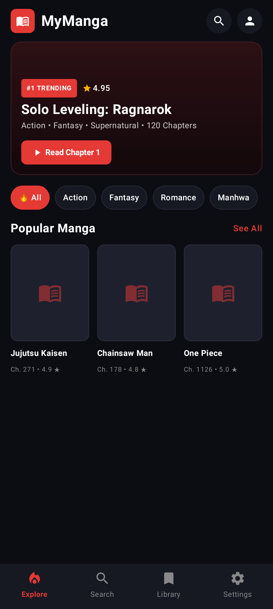

 <p align="center">
  
</p>

<h1 align="center">MyManga</h1>

<p align="center">
  <b>A modern Manga & Webtoon Reader for Android, built with Kotlin, Jetpack Compose and Material 3.</b>
</p>

<p align="center">
  
  
  
  
  
</p>

<p align="center">
  <a href="https://github.com/MyMangaApp/MyManga/releases">
    
  </a>
  <a href="https://github.com/MyMangaApp/MyManga">
    
  </a>
</p>

---

## 📱 App Screenshots

### 🏠 Home, Search and Library

<p align="center">
  
  
  
</p>

### 📖 Manga Reader

<p align="center">
  
  
</p>

### 📊 Activity, Profile and Settings

<p align="center">
  
  
  
</p>

---

## ✨ Key Features

### 🎨 Modern User Interface
- Material Design 3 components with a dark reading interface.
- Responsive layouts and Compose-based UI.
- Customizable reader preferences.

### 📚 Manga Discovery and Search
- Browse and search manga from supported sources.
- Integrated client implementations for MangaDex, MangaFire, Mangapill, WeebCentral and AniList.
- Manga metadata, catalog and search functionality.
- Curated manga catalog support.

*Provider availability and functionality may depend on the source website, network access and current implementation.*

### 📖 Manga and Webtoon Reader
- Reading interface for manga and webtoon content.
- Reader navigation and progress tracking.
- Volume-key navigation support where implemented.
- Reading history and bookmarks.

### 📥 Library and Downloads
- Save manga to your library.
- Organize reading progress and bookmarks.
- Download-related data models and functionality.
- Local storage for supported app data.

### 📊 Reading Analytics
- Reading activity tracking.
- Reading-time and streak-related analytics.
- Reading analytics dashboard components.

### 👤 Profile Customization
- Profile screen and preferences.
- Curated anime avatar and banner data.
- Personalized profile information where supported by the implementation.

### 💾 Backup and Restore
- JSON-based data backup and restoration support.
- Automatic backup worker and scheduling components.
- Backup functionality depends on the app configuration and permissions.

### 🔔 Notifications and Updates
- Notification scheduling and background worker components.
- Boot-related receiver support.
- In-app update dialog and update information interface.
- Update links and release information can be accessed through the configured application flow.

---

## 🆕 What's New in v2.6.0

MyManga v2.6.0 expands the application's source code and UI components.

- Added reading analytics dashboard components.
- Added profile customization components and anime avatar/banner data.
- Added app data backup and restore management.
- Added automatic backup worker and scheduling components.
- Added notification worker and receiver components.
- Added a maintenance screen and owner control panel.
- Added an in-app update dialog.
- Added volume-key navigation management.
- Expanded the curated manga catalog implementation.
- Updated Android application version information to `v2.6.0`.

See the [Releases page](https://github.com/MyMangaApp/MyManga/releases) for downloadable APKs and release-specific changes.

---

## 🛠️ Technology Stack

| Technology | Purpose |
|---|---|
| Kotlin | Primary programming language |
| Jetpack Compose | Android UI framework |
| Material 3 | UI components and design system |
| Android SDK | Application platform |
| Room / SQLite | Local database components |
| DataStore | Local preference storage |
| Kotlin Coroutines | Asynchronous operations |
| WorkManager | Background task support |
| Gradle Kotlin DSL | Build configuration |

The exact libraries and versions used by the project are defined in `gradle/libs.versions.toml` and the Gradle build files.

---

## 📂 Project Structure

```text
MyManga/
├── app/
│   ├── src/
│   │   ├── main/
│   │   │   ├── java/com/example/
│   │   │   │   ├── data/
│   │   │   │   │   ├── local/
│   │   │   │   │   ├── model/
│   │   │   │   │   ├── network/
│   │   │   │   │   └── repository/
│   │   │   │   ├── ui/
│   │   │   │   │   ├── components/
│   │   │   │   │   ├── navigation/
│   │   │   │   │   ├── screens/
│   │   │   │   │   │   ├── detail/
│   │   │   │   │   │   ├── explore/
│   │   │   │   │   │   ├── library/
│   │   │   │   │   │   ├── maintenance/
│   │   │   │   │   │   ├── profile/
│   │   │   │   │   │   ├── reader/
│   │   │   │   │   │   ├── search/
│   │   │   │   │   │   └── settings/
│   │   │   │   ├── theme/
│   │   │   │   └── utils/
│   │   │   ├── res/
│   │   │   └── AndroidManifest.xml
│   │   ├── test/
│   │   └── androidTest/
│   ├── build.gradle.kts
│   └── proguard-rules.pro
├── gradle/
│   └── libs.versions.toml
├── screenshots/
│   ├── logo.png
│   ├── Home_screen.jpeg
│   ├── Search_screen.jpeg
│   ├── Library_screen.jpeg
│   ├── Manga_screen.jpeg
│   ├── Manga_screen2.jpeg
│   ├── Activity_screen.jpeg
│   ├── Profile_screen.jpeg
│   ├── Settings_screen.jpeg
│   └── README.md
├── build.gradle.kts
├── gradle.properties
├── metadata.json
├── settings.gradle.kts
├── .gitignore
├── .env.example
├── LICENSE
└── README.md
```

---

## 🚀 Getting Started

### Prerequisites

- Android Studio compatible with the project's Gradle and Android Gradle Plugin versions.
- A compatible JDK as required by the Gradle configuration.
- Android SDK Platform 35 for the uploaded project configuration.
- Android 6.0 (API 23) or newer to run the app, according to the current `minSdk` setting.

### 1. Clone the repository

```bash
git clone https://github.com/MyMangaApp/MyManga.git
cd MyManga
```

### 2. Open the project

Open the cloned project directory in Android Studio and allow Gradle to synchronize dependencies.

### 3. Configure local secrets if required

The project includes an `.env.example` file for configuration. If a required service needs credentials, configure them locally using the project's expected format.

**Never commit real API keys, passwords, signing credentials or other secrets to the public repository.**

### 4. Build the debug APK

On Windows:

```powershell
.\gradlew.bat assembleDebug
```

On Linux or macOS:

```bash
./gradlew assembleDebug
```

### 5. Build the release APK

On Windows:

```powershell
.\gradlew.bat assembleRelease
```

On Linux or macOS:

```bash
./gradlew assembleRelease
```

The APK output is normally generated under:

```text
app/build/outputs/apk/
```

Build success and APK signing depend on the project's configuration and local environment. Test the resulting APK before distributing it.

---

## 📥 Download MyManga

Visit the official GitHub Releases page to find available application versions:

**[Download MyManga Releases](https://github.com/MyMangaApp/MyManga/releases)**

Older releases may remain available for users who need a previous version. Check each release's notes and assets before installing.

---

## 🤝 Contributing

Contributions, bug reports and suggestions are welcome.

1. Fork the repository.
2. Create a branch for your changes.
3. Make and test your changes.
4. Submit a pull request describing the improvements.

Please include reproducible steps when reporting bugs.

---

## 📄 License and Disclaimer

MyManga is distributed under the **GNU General Public License v3.0 (GPL-3.0)**. See the [`LICENSE`](LICENSE) file for the applicable terms.

Manga titles, artwork, trademarks and other third-party intellectual property belong to their respective owners. MyManga does not claim ownership of third-party content accessed through supported sources. Users are responsible for complying with applicable laws and the terms of the relevant content providers.

---

<p align="center">
  <b>MyManga — Your manga library, your reading journey.</b>
</p>

<p align="center">
  <a href="https://github.com/MyMangaApp/MyManga">GitHub Repository</a>
  ·
  <a href="https://github.com/MyMangaApp/MyManga/releases">Releases</a>
  ·
  <a href="https://github.com/MyMangaApp/MyManga/issues">Report an Issue</a>
</p>
